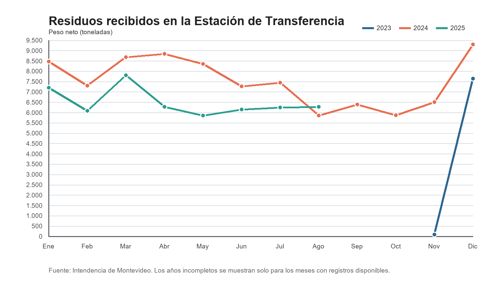

# Introducción a la ciencia de datos

Trabajo de Vicente Álvarez sobre los residuos recibidos en la Estación de Transferencia de Montevideo.

## Organización

- `data/`: archivos CSV de 2023, 2024, 2025 y 2026.
- `graficos/`: gráfico de toneladas de residuos por mes.
- `scripts/`: programas de carga, limpieza, análisis y generación del gráfico.
- `SCRIPT/`: archivos anteriores conservados.

La organización toma como referencia el repositorio [nacho-personalisimo](https://github.com/ncho06-a11y/nacho-personalisimo).

## Ejecución

Desde la carpeta del repositorio, con Python instalado:

```sh
python -m pip install -r requirements.txt
python scripts/carga_datos_y_grafico_completo.py
```

Para generar solamente el gráfico a partir de los CSV existentes:

```sh
python scripts/grafico_residuos.py
```

El resultado se guarda en `graficos/grafico_residuos_mensuales.png`. Los scripts originales utilizan fuentes de Windows; el script completo incluye una fuente alternativa.

## Datos

Fuente: datos abiertos de la Intendencia de Montevideo. Los enlaces de descarga están en el script completo. Los archivos incluidos corresponden a la copia disponible para este trabajo; los períodos pueden estar incompletos. El CSV de 2026 contiene solamente `datos/vacio` y se omite en el análisis.


