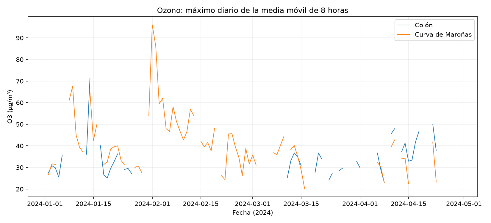

# Introducción a la ciencia de datos - Vicente Álvarez

Trabajo previo sobre residuos de Montevideo y ampliación de actividades a partir del repositorio del docente. Las resoluciones nuevas fueron preparadas con asistencia de Codex el 05/11/2026. El estudiante debe revisarlas y poder explicar cada resultado antes de presentarlas como entrega.

## Actividades

| Clase | Contenido | Programa o respuesta | Resultados |
|---|---|---|---|
| 3 | Fundamentos, 12 preguntas | [Respuestas justificadas](clases/clase03/fundamentos.md) | En el mismo documento |
| 3 | Crear y cargar datasets, ejercicios 1-8 | [resolver.py](clases/clase03/resolver.py) | [Resultados](salidas/clase03/resultados.md) |
| 5 | Carga e inspección de residuos y empresas DEI | [inspeccionar.py](clases/clase05/inspeccionar.py) | [Resultados](salidas/clase05/resultados.md) |
| 7 | Ozono mensual y máximo diario de media móvil 8 h | [ozono.py](clases/clase07/ozono.py) | [Resultados](salidas/clase07/resultados.md) |
| 10 | Tránsito y aire: asociación, ciclo diario, rezagos y modelo | [transito_aire.py](clases/clase10/transito_aire.py) | [Resultados](salidas/clase10/resultados.md) |
| 11 | Preparación y validación de lectura de ticket con IA | [leer_ticket.py](clases/clase11/leer_ticket.py) | [Pendientes de ejecución](clases/clase11/estado.md) |
| 12 | Siete ejercicios de tránsito y aire | [resolver.py](clases/clase12/resolver.py) | [Resultados](salidas/clase12/resultados.md) |
| 14 | Unir tablas, ejercicios 58-61 | [resolver.py](clases/clase14/resolver.py) | [Respuestas](salidas/clase14/respuestas.md) |

El trabajo de residuos se conserva en `scripts/`, `data/` y `graficos/`. `SCRIPT/` contiene versiones anteriores.

## Cómo ejecutar

Python 3.12 (entorno comprobado). Desde la raíz:

```sh
python -m pip install -r requirements.txt
python datos/obtener_datos.py
python clases/clase03/resolver.py
python clases/clase05/inspeccionar.py
python clases/clase07/ozono.py
python clases/clase10/transito_aire.py
python clases/clase12/resolver.py
python clases/clase14/resolver.py
python funciones/test_utilidades.py
python clases/clase11/leer_ticket.py
```

El último comando solo prepara la lectura; no envía la imagen. Los scripts generan tablas e informes en `salidas/` y figuras en `graficos/`. Los CSV de residuos previos deben estar en `data/` para la clase 5 y el trabajo original.

## Material personal

- [Diario real de esta preparación](diario/2026-11-05.md).
- [Errores y correcciones observados](errores/errores.md).
- [Funciones reutilizables](funciones/utilidades.py) y [pruebas](funciones/test_utilidades.py).
- [Recetas](recetas/): lectura de CSV, rutas y uniones, ventanas temporales y manejo de claves.
- [Fuentes y obtención](datos/fuentes.md).
- [Comprobaciones y límites](VALIDACION.md).

## Qué falta del estudiante

Confirmar el tema y resolver el desafío específico del equipo; completar las experiencias personales previas del diario; ejecutar y revisar la lectura del ticket con una cuenta propia; leer y explicar las soluciones. La clase 10 analiza la tabla horaria del docente y no reconstruye su emparejamiento espacial de sensores. No se afirma que esta ampliación cubra toda exigencia de evaluación o participación del curso.

## Uso de IA y atribución

Codex redactó las soluciones nuevas, las funciones, las recetas y los informes, y ejecutó las comprobaciones descritas. No son respuestas previamente aportadas por el estudiante ni se copió el trabajo del compañero. El diario registra esta sesión y no inventa un historial semanal.

Las preguntas y los datos de práctica se atribuyen a [Joselina Davyt-Colo y el repositorio del curso](https://github.com/DavytJ/Introduccion-a-la-ciencia-de-datos). Se tomó como referencia su versión `71cbebe1b3cd96d58b4bc9789fd016c7ac874cbd`. La organización de los repositorios de compañeros sirvió para identificar materiales ausentes; sus respuestas y diarios no se incorporaron.


